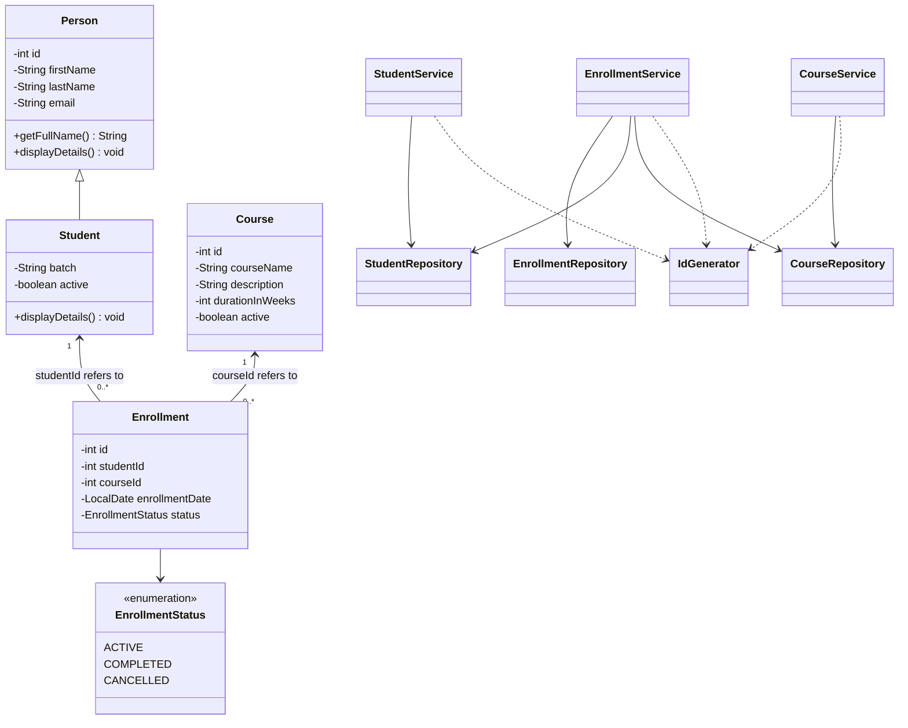
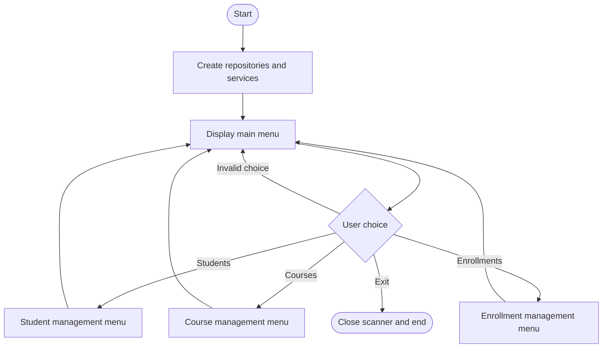

<<<<<<< HEAD
# LearnTrack — Student and Course Management System

LearnTrack is a beginner-friendly **Core Java console application** for managing students, courses, and course enrollments. It stores records in memory using `ArrayList`; data is reset when the application exits.

## Features

- Add, list, find, update, and deactivate students.
- Add, list, find, update, and deactivate courses.
- Enroll an active student in an active course.
- Prevent a student from having duplicate active enrollment in the same course.
- View enrollments, update enrollment status, and cancel an enrollment.
- Generate separate IDs for students, courses, and enrollments.
- Validate required fields and course duration.
- Handle invalid menu input and expected application errors.
- Demonstrate encapsulation, inheritance, constructor use, method overriding, enums, collections, and `LocalDate`.

## Requirements

- JDK 11 or newer
- IntelliJ IDEA, Eclipse, or another Java IDE (optional)

## Project structure

```text
LearnTrack/
├── README.md
├── docs/
│   ├── Setup_Instructions.md
│   ├── JVM_Basics.md
│   ├── Design_Notes.md
│   └── diagrams/
│       ├── class-diagram.mmd
│       └── application-flow.mmd
└── src/
    └── com/airtribe/learntrack/
        ├── Main.java
        ├── constants/AppConstants.java
        ├── entity/
        │   ├── Person.java
        │   ├── Student.java
        │   ├── Course.java
        │   └── Enrollment.java
        ├── enums/EnrollmentStatus.java
        ├── exception/LearnTrackException.java
        ├── repository/
        │   ├── StudentRepository.java
        │   ├── CourseRepository.java
        │   └── EnrollmentRepository.java
        ├── service/
        │   ├── StudentService.java
        │   ├── CourseService.java
        │   └── EnrollmentService.java
        └── util/IdGenerator.java
```

## Run the application

See [`docs/Setup_Instructions.md`](docs/Setup_Instructions.md) for IntelliJ and command-line instructions.

## Class diagram



## Application flow diagram



## Design decisions and limitations

- **Console UI:** `Main.java` contains the menu and input handling; there is no separate `Menu.java`.
- **Layering:** the menu calls service classes; services apply rules and use repositories; repositories hold data in `ArrayList` collections.
- **In-memory storage:** records do not persist after the program stops. A database or file storage is outside the current scope.
- **Deactivation:** removing a student or course sets its `active` field to `false` rather than physically deleting the record. This preserves references from existing enrollments.
- **Enrollment relationships:** `Enrollment` stores `studentId` and `courseId`, and `EnrollmentService` checks the corresponding records before enrolling.
- **No lambda expressions:** the implementation uses ordinary loops and conditionals for clarity while learning Core Java.

## Documentation

- [Setup Instructions](docs/Setup_Instructions.md)
- [JVM Basics](docs/JVM_Basics.md)
- [Design Notes](docs/Design_Notes.md)
- [Class diagram source](docs/diagrams/class-diagram.mmd)
- [Application flow source](docs/diagrams/application-flow.mmd)

## Suggested manual test checklist

1. Add a student and confirm that an ID is displayed.
2. List students and find the student by ID.
3. Update the student and verify the updated values.
4. Add a course and verify that a positive duration is required.
5. Enroll the student in the course.
6. Try to create the same active enrollment again; it should be rejected.
7. Change an enrollment to `COMPLETED` or `CANCELLED`.
8. Deactivate a student or course and confirm it cannot be used for a new enrollment.
9. Enter letters at a numeric prompt and confirm the application asks again.
10. Exit using `0`.

## Repository and pull request

After reviewing and testing locally, publish the project to your own public GitHub repository and submit the repository URL and pull request URL wherever your assignment asks for them. These links must be created in GitHub; they are not generated by this project.
=======
# Airtribe
Java console-based student and course management system
>>>>>>> e7315bf687d1dc19579b84f97140f2b9f0333b6b
